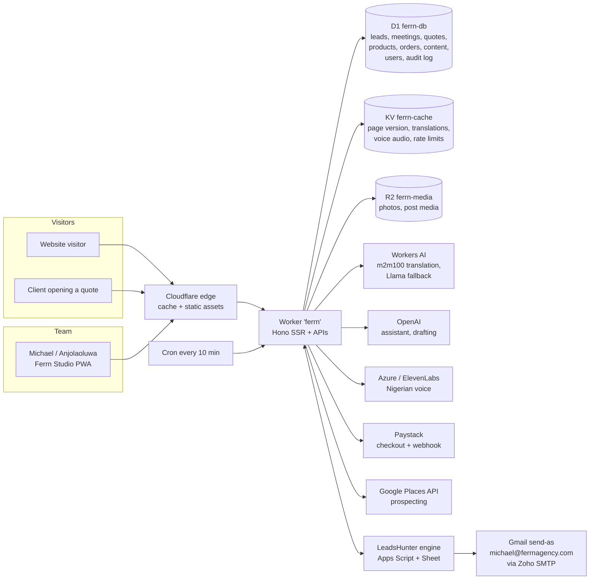

# Architecture



## Request flow

- **Public pages** are rendered on the server (Hono JSX) and cached at the edge for 5 minutes. The cache key includes the language, a *content version* held in KV, and the asset version. Any Studio edit to public content bumps the content version, so visitors see changes on their next request with no manual purge. Signed-in users always bypass the cache.
- **Static files** (`public/`) are served by Workers Static Assets. `_headers` sets long cache lifetimes. Fonts are immutable; CSS and JS are versioned with `?v=`.
- **Studio** is a single-page React app at `/studio/*`. It installs as an app (manifest and service worker). The service worker caches only the app shell and never API responses, so data is always live.

## Data and permissions

- Roles: **owner** > **admin** > **editor** > **sales** > **viewer**. Sales can work leads, meetings and quotes. Editors manage website content and marketing. Admins also manage team access and settings. Only the owner can create other admins.
- Every write goes through one generic resource API (`/api/studio/r/:resource`). It records `updated_by` / `updated_at` and writes an `audit_log` row with a before/after diff. That powers "Edited by …", per-record History, and the Activity feed.
- Sessions use random tokens stored only as SHA-256 hashes, in an HttpOnly, Secure, SameSite=Lax cookie. Passwords use PBKDF2 (100k iterations). Every change request has its Origin checked.

## Leads pipeline

1. **Sources:**
   - Google Maps (Studio → Find leads), scored for opportunity: rating, reviews, no website, and so on.
   - The LeadsHunter engine's research queue.
   - Website forms and the chat assistant, captured automatically.
   - Manual entry.
2. **Outreach:** the engine sends from Gmail as michael@ferrnagency.com, watches replies, and queues WhatsApp messages. Studio shows its queue and can approve, hold or edit messages, or send one now.
3. **Meetings:** each booked call gets a brief. It covers the lead, a call flow, niche-specific questions, objection answers, a suggested product, and optional AI-tailored questions.
4. **Quotes:** built from line items or drafted by AI from call notes. Each quote gets a share link at `/q/:key` where the client can accept, and accepting updates the lead.

## Folder map

```
src/worker/        Worker: index.tsx (routing), routes/, views/ (JSX pages), lib/, content/ (i18n, playbook, calendar)
src/client/site/   Browser JS for the public site (intro, write-on text, chat, forms)
src/studio/        Studio React app
public/            Static assets, demos, built bundles, fonts, manifests
migrations/        D1 schema + seed
engine/            LeadsHunter (Apps Script engine, site templates, content tools) — merged with history
scripts/           build + seed generators
docs/              these docs
```
